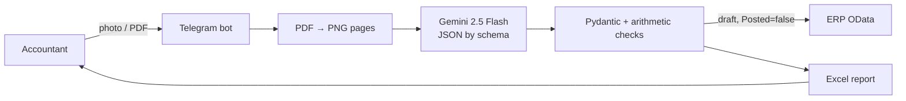

# Document Recognition → ERP


An accountant sends a photo or PDF of an invoice or a service act to a Telegram bot. The bot reads
it with Gemini Vision, **validates the arithmetic**, creates a draft document in the ERP
(1C:Enterprise) via OData and replies with an Excel report.

> **1C:Enterprise** is the dominant ERP and accounting platform in Kazakhstan and the CIS. Its
> standard OData interface is what the bot writes to.

▶ **[Demo video: from an invoice photo to a document in the ERP](docs/demo.mp4)**

## How it works



1. A PDF is split into pages and all pages go into one request: on long invoices the line-item
   table often continues onto page two.
2. The model detects the document type (invoice or service act) and returns JSON matching a
   schema. Documents in Russian and Kazakh are supported.
3. **LLMs make mistakes with digits, so the result is validated arithmetically**: quantity × price
   vs. line total, sum of lines vs. grand total, total + VAT vs. total incl. VAT, 12-digit tax ID,
   date format. Discrepancies don't block the document: they are shown to the accountant, added to
   the Excel report and to the document comment in the ERP marked «ПРОВЕРИТЬ» ("CHECK").
4. The document is created as a **draft**; the accountant posts it after review. If the ERP is
   down, the extracted data still arrives as Excel.

## Mock ERP server

`mock_1c/` is a FastAPI server exposing the same OData interface as 1C, plus a document journal
styled like the 1C UI. It makes the integration possible to develop and demo without access to a
client's database. Switching to a real ERP only changes `ODATA_URL` and credentials.

## Layout

```
docbot/
  extractor.py   PDF → images, Gemini request, response parsing
  schemas.py     document model (Pydantic) and arithmetic validation
  pipeline.py    recognise → validate → send to ERP (no Telegram)
  onec.py        ERP OData client
  excel.py       Excel report
  bot.py         Telegram bot
mock_1c/server.py  mock ERP on FastAPI
tests/           21 tests: amounts, validation, model output parsing, OData, pipeline, Excel
```

## Running

```bash
cp .env.example .env        # TELEGRAM_TOKEN, GEMINI_API_KEY
docker compose up -d --build
open http://127.0.0.1:8000  # mock ERP document journal
```

## Tests

```bash
pip install -r requirements-dev.txt
ruff check . && pytest -q
```

Tests never call Gemini or Telegram. The ERP integration is tested against the mock server through
`TestClient`, i.e. over real HTTP.

Stack: Python 3.12 · python-telegram-bot · Google Gemini · PyMuPDF · Pydantic v2 · httpx · FastAPI ·
openpyxl · Docker Compose · pytest · GitHub Actions. Documents and the bot's replies are in
Russian, and so are the code comments.
